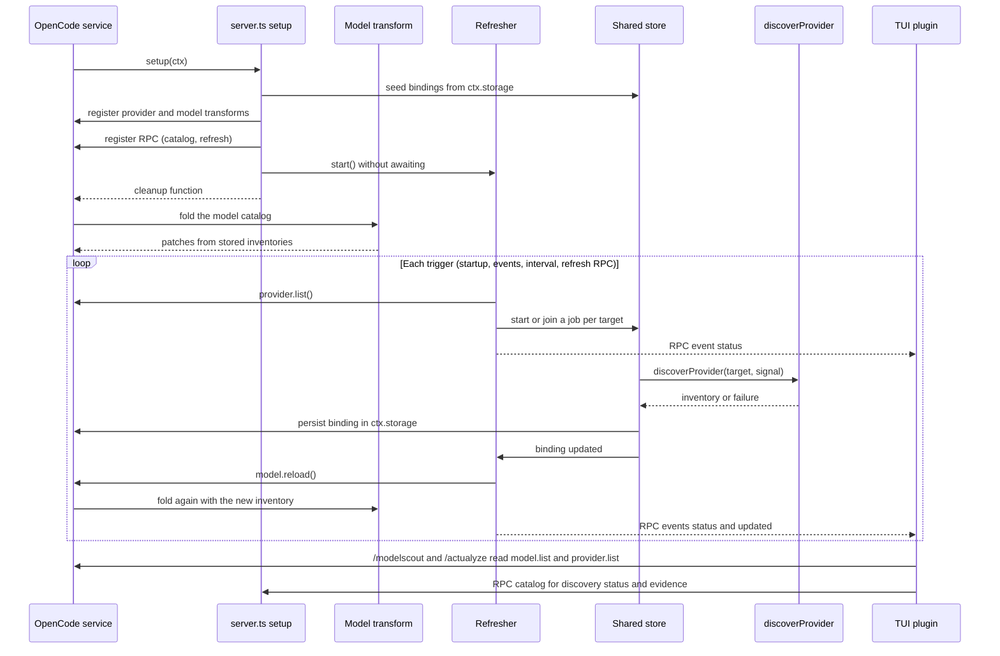
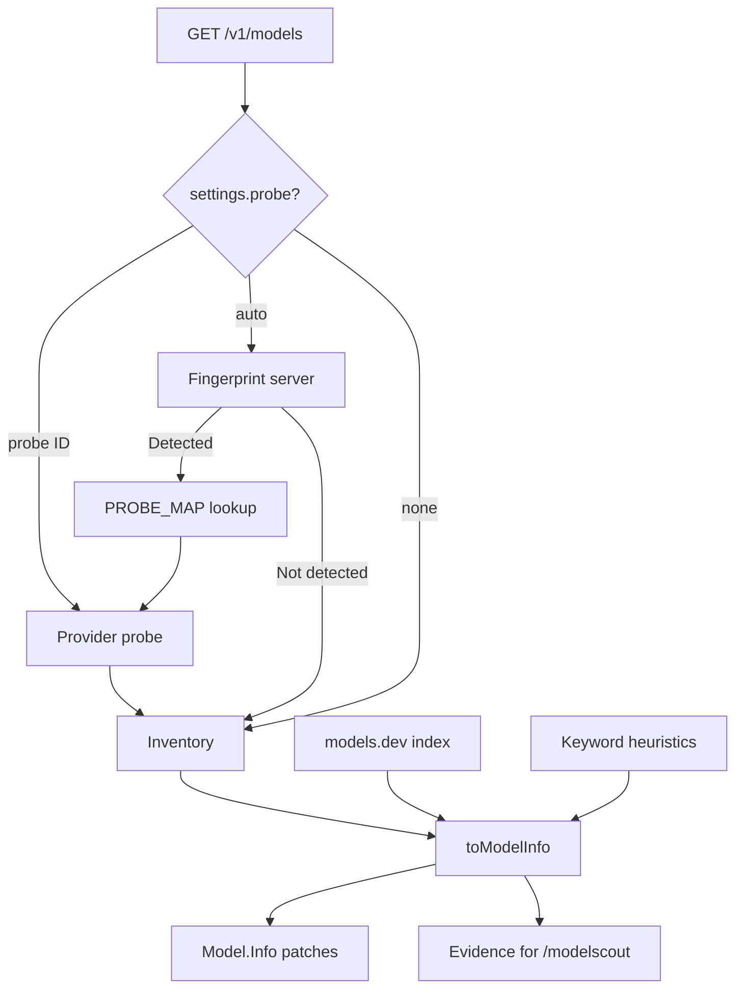
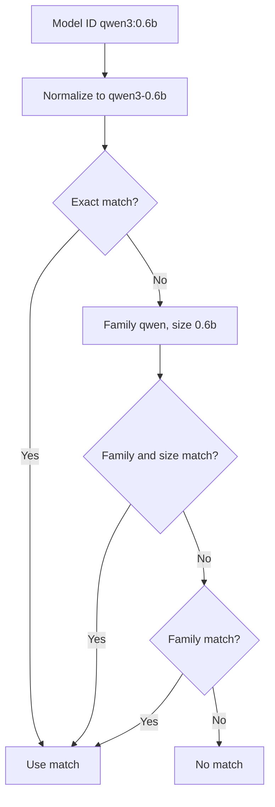
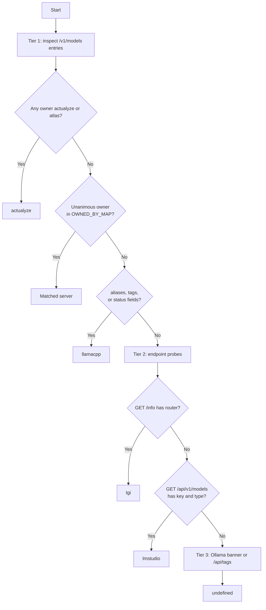

# Contributing to opencode-model-scout

## Prerequisites

- Node.js 22.18 or later. CI runs Node 24. `scripts/live-check.mjs` imports a
  TypeScript source file directly and needs a Node version that strips types
  by default.
- npm.
- For the live harness and the live TUI scenarios only: an installed
  OpenCode 2 CLI (`opencode`), tested with 2.0.32. The TUI scenarios drive it
  through [tuistory](https://www.npmjs.com/package/tuistory), which
  `npm install` adds as a dev dependency.

## Setup

```bash
git clone https://github.com/rmk40/opencode-model-scout.git
cd opencode-model-scout
npm install
```

`npm install` also installs the Husky hooks:

- **pre-commit** runs `lint-staged` (ESLint `--fix` and Prettier on staged
  files).
- **pre-push** runs `npm run check`.

## Commands

```bash
npm run check         # typecheck, lint, format:check, unit, E2E, compile, check:dist (CI gate)
npm run test:e2e      # embedded-host E2E lane only
npm run fix           # eslint --fix + prettier --write
npm run lint          # ESLint only
npm run lint:fix      # ESLint with auto-fix
npm run format        # Prettier write
npm run format:check  # Prettier check only
npm run typecheck     # tsc --noEmit
npm run test          # unit tests in watch mode
npm run test:run      # unit tests once
npm run test:coverage # unit tests with coverage
npm run compile       # tsup → dist/ with type declarations
npm run compile:dev   # tsup → dist/ without declarations
npm run check:dist    # fail on runtime @opencode/* or effect imports in dist/
npm run build         # same as check
```

## Testing

There are two automated lanes, both part of `npm run check`, and two manual
lanes: the live harness and the live TUI scenarios.

### Unit tests

`npm run test:run` runs every `*.test.ts` under `test/` except `test/e2e/`.
`test/setup.ts` replaces `global.fetch` with a `vi.fn()` mock for every file,
so unit tests never reach the network. Mock responses per test:

```bash
npx vitest run test/probes/omlx.test.ts
```

### Embedded-host E2E

`npm run test:e2e` runs `test/e2e/*.e2e.test.ts` with
`vitest.e2e.config.ts`, which leaves out `test/setup.ts` so `fetch` is real.
The tests start an in-process OpenCode host through `@opencode/sdk`, load
`src/server.ts` as a plugin, serve local OpenAI-compatible and Actualyze mocks
over HTTP, and check the host's own model list and the plugin RPC. They need
no network access beyond localhost: `test/e2e/actualyze.e2e.test.ts` wraps
`fetch` so requests to the built-in Actualyze endpoint reach the local mock.

### Live harness

`scripts/live-harness.mjs` runs the installed `opencode` against the built
`dist/` in an isolated scratch tree. It is not shipped and not part of
`npm run check`. Use it whenever a change touches how the plugin talks to the
host. Before a release, run `live-check.mjs` against it and every scenario of
[`scripts/live-tui.mjs`](#live-tui-scenarios).

```bash
npm run compile:dev                # the harness never builds
node scripts/live-harness.mjs start [--actualyze-mock | --actualyze-refused] [--fresh]
node scripts/live-check.mjs
node scripts/live-harness.mjs connect <scenario>
node scripts/live-harness.mjs status
node scripts/live-harness.mjs stop
```

`start` writes a project config with `plugins: ["<repo>/dist"]` and a
`mock-compat` provider backed by a local mock server, then starts
`opencode serve` on `127.0.0.1`. `mock-compat` declares one model,
`mock-tiered-pro`, with two context-priced cost tiers, so the tier display
and the rule that declared models are never patched can be checked. Every
OpenCode process runs with an environment built from scratch, with `HOME`
and the four `XDG_*` variables pointing into the scratch tree, so your real
config, data, and background service are never touched.

| Option                | Effect                                                                                                                         |
| --------------------- | ------------------------------------------------------------------------------------------------------------------------------ |
| `--actualyze-mock`    | Points `providers.actualyze.settings.baseURL` at the harness's Actualyze mock (`http://127.0.0.1:<mock port>/openai/v1`).      |
| `--actualyze-refused` | Points it at a local port that refuses connections, for the `unreachable` failure.                                             |
| `--fresh`             | Deletes the scratch `HOME` and `XDG_*` trees first, so no connection, setting, or stored binding survives from an earlier run. |

Either Actualyze option writes a `providers.actualyze` config entry, which
lists the provider in OpenCode even before a key is connected. Without
either, the config has no such entry unless `ACTUALYZE_BASE_URL` is set
together with a key file.

| Variable                     | Purpose                                                                                                                                                                                        |
| ---------------------------- | ---------------------------------------------------------------------------------------------------------------------------------------------------------------------------------------------- |
| `SCOUT_HARNESS_DIR`          | Scratch tree. Defaults to `opencode-model-scout-harness` under the OS temp directory.                                                                                                          |
| `ACTUALYZE_API_KEY_FILE`     | File holding an inference-scoped Actualyze key. Without it, the checks expect the built-in `actualyze` provider to be hidden. With either Actualyze option, it must hold a synthetic mock key. |
| `ACTUALYZE_BASE_URL`         | Optional Actualyze endpoint, for example `http://localhost:3001/openai/v1`. Defaults to the built-in production endpoint. Not allowed with either Actualyze option.                            |
| `OPENCODE_BIN`               | The `opencode` executable. Defaults to the first `opencode` on `PATH`.                                                                                                                         |
| `SCOUT_HARNESS_PORT`         | Port for `opencode serve`. Defaults to 47931.                                                                                                                                                  |
| `SCOUT_HARNESS_MOCK_PORT`    | Port for the mock server. Defaults to 47932.                                                                                                                                                   |
| `SCOUT_HARNESS_REFUSED_PORT` | Port `--actualyze-refused` points at. Defaults to 47933; `start` fails when something accepts connections on it.                                                                               |

The harness tests the built-in `actualyze` provider the way a user sets it
up. The key reaches the server only as `ACTUALYZE_API_KEY` in its
environment, so discovery and chat go through the integration credential.
It is passed through the spawn environment rather than the command line and
is never written to the config, the state file, or the logs. With
`ACTUALYZE_BASE_URL`, the config sets only
`providers.actualyze.settings.baseURL`.

`live-check.mjs` waits up to 60 seconds for the RPC catalog to report
`complete`, then checks that the plugin is listed and active, that exactly
one Actualyze integration exists, with the ID `actualyze` and a connection
only when a key file is set, that the `actualyze` provider is listed with
the expected endpoint and no `settings.apiKey` (or hidden, without a key
file), that the discovered models carry the expected limits, capabilities,
variants, and prices (Actualyze expectations come from the endpoint's own
`/models` list), that embedding models are not offered for chat, that the
declared `mock-tiered-pro` keeps its configured name, limits, and cost
tiers, that the RPC catalog passes the strict v5 validator with settled
records (not discovering, `resultEpoch` equal to `credentialEpoch`) and the
expected `credentialSource`, and that one plain chat request succeeds
against the first model in the Actualyze list, without an effort variant.
Pass `--skip-chat` to skip the chat request or
`--chat-model <provider/model>` to pick its model.

After `start --actualyze-mock`, `live-check.mjs` takes its Actualyze
expectations from the synthetic key in `ACTUALYZE_API_KEY_FILE`: a failing
scenario expects its failure kind, HTTP status, no models, and for 429 a
`retryAt` from `Retry-After` and a `nextRefreshAt` at the later of that and
the one-minute floor. Without a key file it expects the mock's 401. After
`start --actualyze-refused` it expects `unreachable`. With the `readonly`
key it expects the chat request to be refused.

The scripts print only the fields they check. Never print a raw `model.list`
or `provider.list` response while debugging: both contain provider settings
with the plaintext API key.

### Actualyze mock

The mock server also serves an Actualyze mount under `/openai/v1`, in the
response shapes Actualyze uses. It picks its behavior from the request's key
(`Authorization: Bearer` or `X-Actualyze-Api-Key`), which must be
`aai_pat_mock_<scenario>`. Any other key, or none, gets the 401 Actualyze
sends for every rejected key. Only these synthetic keys are ever used with
the mock; `start` refuses a real key in `ACTUALYZE_API_KEY_FILE` when an
Actualyze option is set.

| Scenario          | Model list answer                                                                                                   | Failure scout records |
| ----------------- | ------------------------------------------------------------------------------------------------------------------- | --------------------- |
| `ok`              | Six models with modalities and most with prices; one is a virtual model with unknown fields, one an embedding model | none                  |
| `empty`           | An empty list                                                                                                       | none                  |
| `revoked`         | 401                                                                                                                 | `unauthorized`        |
| `forbidden`       | 403                                                                                                                 | `forbidden`           |
| `budget`          | 402 with `insufficient_quota`                                                                                       | `payment-required`    |
| `throttled`       | 429 with `Retry-After: 90`                                                                                          | `rate-limited`        |
| `throttled_short` | 429 with `Retry-After: 30`, so the countdown shows the one-minute floor instead                                     | `rate-limited`        |
| `5xx`             | 503                                                                                                                 | `server-error`        |
| `slow`            | No response headers for 12 seconds, past the 10-second list timeout                                                 | `timeout`             |
| `slow_body`       | Headers at once, then a body that stalls for 12 seconds, past the body-read timeout                                 | `timeout`             |
| `readonly`        | The full list; every chat request gets 403                                                                          | none                  |

`connect <scenario>` connects `aai_pat_mock_<scenario>` to the `actualyze`
integration of the running harness through the server API, the way a user
connects a stored key. It needs a harness started with `--actualyze-mock`
to reach the mock.

### Live TUI scenarios

`scripts/live-tui.mjs` drives the installed TUI (`opencode --standalone`) in
the harness scratch tree through the tuistory library and checks what it
shows. It manages the harness itself: each run restarts it with `--fresh`
and the scenario's Actualyze option, and the harness is stopped at the end,
including one that was already running.

```bash
npm run compile:dev
node scripts/live-tui.mjs                                   # every scenario, both sizes, both themes
node scripts/live-tui.mjs --list                            # scenario names and what each proves
node scripts/live-tui.mjs --scenario actualyze-revoked --size 80x24 --theme light
node scripts/live-tui.mjs --screenshots "$TMPDIR/scout-shots" # save PNG and text screenshots
```

| Option                 | Effect                                                                                        |
| ---------------------- | --------------------------------------------------------------------------------------------- |
| `--scenario <name>`    | Run only this scenario. Repeat it to run several.                                             |
| `--size 120x36\|80x24` | Run at one terminal size. Repeatable. Without it, both sizes run.                             |
| `--theme dark\|light`  | Run with one theme mode, written to the scratch `cli.json`. Repeatable. Without it, both run. |
| `--screenshots <dir>`  | Save each `screenshot` step as a PNG and a text snapshot in `<dir>`.                          |
| `--list`               | Print the scenarios and exit.                                                                 |

Each run connects the scenario's synthetic key, if it has one, through the
server API before the TUI starts, launches the TUI with the same isolated
environment as the harness, checks that the chosen theme is applied, and
runs the scenario's steps. Then it waits for the harness server's catalog
to settle and checks it against the v5 validator and the scenario's own
catalog checks.

The runner refuses to start while `ACTUALYZE_API_KEY_FILE` or
`ACTUALYZE_BASE_URL` is set, so only synthetic `aai_pat_mock_*` keys are ever
in play. It checks that a key never leaks:

- After a key is connected or typed, no screen the runner reads may contain
  it.
- A key connected before the TUI started was never typed, so the TUI's whole
  output stream must not contain it either.
- At the end of each run, the key must not appear in the harness server's
  RPC catalog payload, in any server, TUI, or mock log, or in the saved
  screenshots (PNG bytes and text snapshots).

Failure output replaces every synthetic key with `[synthetic key]` before it
prints the screen.

To add a scenario, append an entry to `SCENARIOS` in `scripts/live-tui.mjs`:

```js
{
  name: "actualyze-throttled-short",
  description: "a 429 with Retry-After 30: the countdown starts from the one-minute floor",
  actualyze: "mock", // harness start mode: "default", "mock", or "refused"
  connect: "throttled_short", // optional mock scenario whose key is connected first
  sizes: ["120x36"], // optional subset of the sizes
  steps: [
    { command: "/actualyze" },
    { wait: /Catalog rate limited · retry in \d+ s/, timeout: 30_000 },
    { expectColor: { color: "brand", text: "ACTUALYZE" } },
    {
      label: "the wait is longer than Retry-After",
      run: async (ctx) => {
        const text = await ctx.session.text();
        const seconds = Number(/retry in (\d+) s/.exec(text)?.[1]);
        if (!(seconds > 30)) throw new Error(`countdown ${seconds}`);
      },
    },
    { screenshot: "throttled-short" },
    { press: "esc" },
    { waitGone: "ACTUALYZE" },
  ],
  catalog: (payload, ctx) => {
    const record = payload.providers.find((item) => item.id === "actualyze");
    ctx.check("429 recorded", record?.failure?.kind === "rate-limited");
  },
}
```

| Step                                      | Effect                                                                                      |
| ----------------------------------------- | ------------------------------------------------------------------------------------------- |
| `{ command: "/name" }`                    | Type a slash command and press `enter`                                                      |
| `{ wait: text }`                          | Wait until a string or `RegExp` is on screen (default 15 seconds; `timeout` changes it)     |
| `{ waitGone: text }`                      | Wait until it is gone                                                                       |
| `{ expect: text }`, `{ expectNot: text }` | Check that it is, or is not, on the current screen                                          |
| `{ expectColor: { color, text } }`        | Check text drawn in exactly that foreground; `"brand"` is the Actualyze purple of the theme |
| `{ type: "abc" }`, `{ press: "esc" }`     | Type text or press a key; `press` also takes a chord such as `["ctrl", "p"]`                |
| `{ submitKey: "ok" }`                     | Type the scenario's synthetic key and press `enter`                                         |
| `{ resize: "across" }`                    | Resize across 120 columns; `"restore"` returns to the run's size                            |
| `{ screenshot: "label" }`                 | Save a screenshot when `--screenshots` is set                                               |
| `{ sleep: 500 }`                          | Pause                                                                                       |
| `{ run: async (ctx) => {} }`              | Anything else; throw to fail the step                                                       |

Every step can carry a `label` for the report. A new `connect` value must be
a key of `ACTUALYZE_MOCK_SCENARIOS` in `scripts/live-harness.mjs`; add the
mock behavior there first when a scenario needs a new answer.

`scripts/report-actualyze-model-capabilities.mjs` is a separate developer tool
that reports what an Actualyze endpoint advertises per model.

## Architecture

### Plugin lifecycle

The server half runs inside OpenCode's background service, once per open
location. The TUI half runs in the terminal client and talks to the server
half over plugin RPC.



### Server half

- **`src/server.ts`** adapts the plugin context for the refresher, loads
  persisted bindings, registers the Actualyze integration, the two catalog
  transforms, and the RPC handlers, and starts the refresher. It awaits no
  network I/O.
- **`src/actualyze.ts`** defines the built-in Actualyze provider and its
  integration (a key method and the `ACTUALYZE_API_KEY` environment
  variable). The integration ID is `actualyze`, the provider ID, because the
  host's config provider plugin registers an integration under the provider
  ID for every `providers.<id>` entry unless one exists, and
  `opencode auth login actualyze` resolves an integration by exact ID first;
  any other ID would leave a configured provider reading keys from an
  integration nobody connects. The provider is added only when no
  `actualyze` provider exists yet, and the integration only when no
  `actualyze` integration exists, so a models.dev catalog that defines them
  keeps them. An earlier plugin's `actualyze` provider with
  `activation: "auto"` and no integration of its own is gated by this
  integration and stays hidden until it has a connection.
- **`src/transform.ts`** holds the provider transform and the model transform.
  The provider transform stores the provider IDs that exist before config
  providers load, then adds the Actualyze provider, so that provider never
  counts as pre-existing; `eligibleTarget()` uses the stored set to decide
  which providers are auto-eligible. The model transform runs in two passes:
  a pure pass maps each target's inventory to patches inside `try`/`catch`,
  then a second pass applies them with `editor.update`. Model IDs already in
  the provider's source record are skipped. Every target is served only
  through the binding the refresher made active for this instance after
  resolving its credential.
- **`src/refresher.ts`** turns host events, the refresh interval, and RPC
  `refresh` calls into debounced syncs. A sync resolves each target's
  credential in the order the host uses for chat (the integration's active
  connection, then `settings.apiKey`, then none), activates a stored binding
  for it, subscribes to the target's store entry, starts discovery for
  stale or changed targets, and reloads the catalog when a served binding
  changes. It also builds the RPC `catalog` payload. It keeps one catalog
  record per provider ID across syncs, so a record survives a credential
  switch or a failed lookup, and counts credential changes in
  `credentialEpoch`, so a client can tell a result for the current key
  from one for an earlier key.
- **`src/store.ts`** is the process-wide store on `globalThis`. It owns
  bindings and jobs keyed by the full target fingerprint plus, unless the
  target resolved to its `settings.apiKey`, the fingerprint of its resolved
  credential. It throttles starts to one per minute per key (a job aborted
  because its last subscriber left does not count), holds a key back until
  the `retryAt` a failed model list set, and bumps a generation on
  invalidation so stale job results are dropped.
- **`src/discover.ts`** contains `discoverProvider()`, which fetches
  `/v1/models`, resolves and runs the probe, and returns an inventory or a
  classified failure (an HTTP kind with its status, `unreachable`,
  `timeout`, and others, with `retryAt` from `Retry-After` or
  `X-RateLimit-Reset`), and `toModelInfo()`, the pure mapping from an
  inventory to `Model.Info` patches and evidence records.

### Enrichment pipeline



`toModelInfo()` resolves each field from the strongest source that has it:
probe evidence (including authoritative negatives), then a models.dev match,
then keyword heuristics on the model ID, then OpenCode's defaults. Each value
is recorded with its source and strength in a `CatalogModelRecord`, which the
TUI shows as source labels.

Mapping rules worth knowing:

- An unknown output limit is emitted as `0`, which the host reads as
  "unknown". A known output limit is capped at the known context.
- Image input is added only on image evidence. Unknown image support stays
  text-only rather than taking the host's text-and-image default.
- Reasoning models on an openai-compatible package get `low`, `medium`, and
  `high` variants with `settings.reasoningEffort`. Actualyze models and
  embedding models get none.
- Embedding models are emitted with `enabled: false`.
- Parameter size, quantization, disk size, and temperature support have no
  `Model.Info` field. They exist only as evidence.

### models.dev matching

`src/models-dev-index.ts` builds the matcher from `editor.provider.list()`
inside the model transform. It uses the provider records that existed before
config providers loaded (models.dev templates and built-ins), minus discovery
targets and the never-probed providers. The index is memoized on the
identities of the provider records.



Normalization strips an owner prefix (`qwen/qwen3-30b` becomes `qwen3-30b`),
replaces `:` with `-`, and lowercases. The family is the leading run of
letters. Size matching uses digit boundaries so `4b` does not match inside
`14b`.

OpenCode normalizes models.dev before plugins see it, so a match can supply
only these values:

| From a match                                   | Not from a match |
| ---------------------------------------------- | ---------------- |
| tool support                                   | context limit    |
| image, PDF, audio, and video input             | output limit     |
| family                                         | temperature      |
| reasoning, when the record has effort variants | prices           |

A match without effort variants leaves reasoning unknown, not unsupported,
because the host derives variants per provider package.

### Server to TUI

`src/rpc.ts` defines the RPC contract as a plain object:

- `catalog({})` returns the evidence payload defined in
  `src/catalog-evidence.ts` (schema version 5). The payload carries the
  catalog status and timestamps, a random `instanceID` that changes when the
  server half reloads or restarts, the server time `generatedAt` for
  countdowns, and `builtIn.actualyze`: `foreign` when another source defined
  the `actualyze` provider and it is not a discovery target, otherwise
  `managed`. Each target provider has one record with its endpoint origin,
  probe selection, last good inventory time, and per-model evidence, plus
  its status:
  - `discovering`, `lastAttemptAt`, and `nextRefreshAt`, the later of the
    last start plus one minute and the failure's `retryAt`, or null once it
    has passed.
  - `credentialSource`: `connection`, `settings`, `headers` (provider
    headers replace the key), `none`, or `unresolved`.
  - `credentialEpoch`, which goes up whenever the resolved credential
    changes, and `resultEpoch`, the epoch the record's result belongs to.
    A record is current when the two are equal. A record whose credential
    changed and has no result yet carries no models and no failure.
  - `failure`: `{ kind, at, httpStatus?, retryAt? }`. The HTTP kinds
    (`unauthorized`, `forbidden`, `payment-required`, `rate-limited`,
    `not-found`, `server-error`, `http-error`) carry their status; the
    others are `unreachable`, `timeout`, `aborted`, `invalid-response`, and
    `error`.
- `refresh({ providerID? })` starts discovery for one target or all of them
  and returns `{ accepted, reason? }`. It joins an in-flight job and respects
  each record's `nextRefreshAt`. When nothing starts or joins, `reason` is
  `throttled` or `no-targets`.
- The `updated` event carries `{ completedAt }` after a discovery cycle, and
  after a sync first resolves the targets or changes the bindings they
  serve. The status is `pending` only until that first sync; with no job
  running it is `complete` as of the newest served inventory.
- The `status` event carries `{ at }` when a record's status may have
  changed: a job started, was joined, or settled, or credential resolution
  changed an epoch. Changes in one turn publish one event.

The TUI captures one location when a dialog opens and passes it in every RPC
call. It validates every `catalog` response with `validateCatalogPayload()`
before use and reads the catalog again, coalesced, on either event. If the
call fails, the browser falls back to the host's model and provider lists
with a notice.

### TUI half

- **`src/tui.ts`** registers `/modelscout` and `/actualyze` in a global
  keymap layer and closes any open dialog on cleanup.
- **`src/tui-session.ts`** opens the browser dialog, reads OpenCode's
  provider and model lists and the RPC catalog in parallel with timeouts,
  reads them again on the RPC events and the host's `model.updated`, keeps
  navigation state in `storage.memory`, and runs refresh, copy, and
  notices.
- **`src/tui-browser.ts`** builds the view inside the dialog render: it
  projects provider groups into rows, picks the wide or narrow layout,
  switches screens, and routes keys through the pure router in
  `src/tui-keys.ts`. A caller can wrap it in a frame (a header, a status
  line, cards, extra keys); `/actualyze` is that caller.
- **`src/tui-detail.ts`** builds the details, Evidence, and key list as
  lines of role-tagged segments. **`src/tui-list.ts`** paints rows as one
  StyledText node each and fits text by terminal column.
  **`src/tui-theme.ts`** maps the roles to dialog-surface colors.
- **`src/tui-actualyze.ts`** holds the pure `/actualyze` logic: the state
  table, the pending-key reducer, the endpoint origin, and the app links.
  **`src/tui-actualyze-view.ts`** runs `/actualyze` sessions, the key flow,
  the cards, and the links screen.

### Server auto-detection

`fingerprint()` in `src/probes/fingerprint.ts` identifies the server when
`settings.probe` is `"auto"`:



- **Tier 1** reads the already-fetched model list and makes no requests. An
  exact `owned_by` of `actualyze` or `atlas` on any entry selects Actualyze,
  even in a mixed catalog. Other owners (`omlx`, `vllm`, `sglang`,
  `llamacpp`, `koboldcpp`, and `library` for Ollama) must be unanimous.
- **Tier 2** probes server-specific endpoints in sequence under a 2-second
  budget.
- **Tier 3** recognizes Ollama by its banner or `/api/tags` but returns
  `undefined`, so an Ollama server without unanimous `library` owners needs an
  explicit `"probe": "ollama"`.

`PROBE_MAP` maps each detected server to its probe. `llamacpp` maps to the
`ollama` probe, because llama.cpp serves Ollama-compatible endpoints.

## Adding a Probe

Probes are the most useful contribution: if your inference server has a
metadata API, a probe makes its models first-class in OpenCode. Read
[`src/probes/AGENTS.md`](src/probes/AGENTS.md) before you start; it lists the
rules every probe follows.

### Probe contract

```typescript
type ProviderProbe = (
  baseURL: string, // normalized, without a trailing /v1
  apiKey?: string,
  context?: ProbeContext,
) => Promise<ProbeResult>;

interface ProbeContext {
  /** The /v1/models entries discovery already fetched */
  modelsResponse?: OpenAIModelEntry[];
  /** Whether the probe was chosen by auto-detection or named explicitly */
  probeSelection?: "auto" | "explicit";
  /** Discovery cancellation signal */
  signal?: AbortSignal;
  /** Provider headers to send on every probe request */
  headers?: Readonly<Record<string, string>>;
}

interface ProbeResult {
  models: Record<string, ProbeModelMeta>;
}
```

Every probe must:

1. Make HTTP calls with `probeFetch()` from `./util` and pass
   `context.signal` to it.
2. Build headers with `buildHeaders(apiKey, context?.headers)`, so the API key
   and the provider's headers reach the server.
3. Read bodies with `readJson()` or `readBody()`, never raw `res.json()` or
   `res.text()`. The helpers bound the body read and cancel the stream.
4. Never throw. Catch everything and return `EMPTY_RESULT`.
5. Never write to stdout or stderr. Probes run inside OpenCode's shared
   background service.
6. Leave unknown values undefined. Return `false` only when the server
   reports it; a `false` is authoritative and overrides models.dev.

### Step by step

1. Create `src/probes/yourserver.ts`:

   ```typescript
   import type { ProbeModelMeta, ProbeResult, ProviderProbe } from "./types";
   import { buildHeaders, EMPTY_RESULT, probeFetch, readJson } from "./util";

   export const probeYourServer: ProviderProbe = async (
     baseURL,
     apiKey,
     context,
   ): Promise<ProbeResult> => {
     try {
       const res = await probeFetch(`${baseURL}/api/model-info`, {
         headers: buildHeaders(apiKey, context?.headers),
         signal: context?.signal,
       });
       if (!res) return EMPTY_RESULT;
       if (!res.ok) return EMPTY_RESULT;

       const data = await readJson<{ models?: unknown[] }>(res);
       if (!data || !Array.isArray(data.models)) return EMPTY_RESULT;

       const models: Record<string, ProbeModelMeta> = {};
       for (const raw of data.models) {
         const entry = raw as Record<string, unknown>;
         if (typeof entry.id !== "string") continue;
         models[entry.id] = {
           context:
             typeof entry.context_window === "number"
               ? entry.context_window
               : undefined,
           vision: entry.supports_vision === true ? true : undefined,
           toolCall: entry.supports_tools === true ? true : undefined,
         };
       }
       return { models };
     } catch {
       return EMPTY_RESULT;
     }
   };
   ```

   If the server's `/v1/models` entries already carry the metadata (vLLM's
   `max_model_len`, for example), read `context.modelsResponse` instead of
   making another request.

2. Register it in `PROBES` in `src/probes/index.ts`. `ProbeKey` derives from
   that object, so the new ID becomes a valid `settings.probe` value.
3. For auto-detection, update `src/probes/fingerprint.ts` (see below).
4. Add `test/probes/yourserver.test.ts`. Mock `fetch` and cover the success
   path, HTTP errors, malformed bodies, and partial data. The existing probe
   tests are good templates.
5. Add the server to the Supported Servers table in `README.md`.

### `ProbeModelMeta` fields

All fields are optional. `discover.ts` runs every probe result through
`sanitizeProbeMeta()`, which drops values of the wrong type, so a new field
also needs a line there.

| Field             | Type                                                   | Description                                              |
| ----------------- | ------------------------------------------------------ | -------------------------------------------------------- |
| `context`         | `number`                                               | Context window in tokens                                 |
| `maxTokens`       | `number`                                               | Maximum output tokens                                    |
| `modelType`       | `"llm" \| "vlm" \| "embedding"`                        | Model classification                                     |
| `toolCall`        | `boolean`                                              | Tool calling support                                     |
| `reasoning`       | `boolean`                                              | Reasoning or thinking support                            |
| `temperature`     | `boolean`                                              | Temperature control support                              |
| `vision`          | `boolean`                                              | Image input support                                      |
| `inputModalities` | `("text" \| "image" \| "pdf" \| "audio" \| "video")[]` | Authoritative input list; replaces `vision` when present |
| `cost`            | `{ input, output, cacheRead?, cacheWrite? }`           | Prices in USD per million tokens                         |
| `loaded`          | `boolean`                                              | Currently loaded in memory                               |
| `sizeBytes`       | `number`                                               | Model file size on disk                                  |
| `parameterSize`   | `string`                                               | Parameter count, such as `"30.5B"`                       |
| `family`          | `string`                                               | Model family, such as `"qwen3"`                          |
| `quantization`    | `string`                                               | Quantization level, such as `"Q4_K_M"`                   |

### What makes a good probe

- **Fast.** Finish well inside the discovery budget (15 seconds by default)
  even with many models.
- **Parallel and bounded.** For per-model calls, use a bounded worker pool or
  `Promise.allSettled()`.
- **Resilient.** One model's failed request must not discard the others.
- **Accurate.** Report only what the server's API states.

### Adding a server fingerprint

To make a new server detectable with `"probe": "auto"`, edit
`src/probes/fingerprint.ts`:

1. Add the server to the `DetectedServer` union and to `PROBE_MAP`. Map it to
   an existing probe key if the server is API-compatible with one.
2. If the server sets a distinctive `owned_by`, add it to `OWNED_BY_MAP`.
   That costs no requests.
3. Otherwise add a Tier 2 check before the Tier 3 section:

   ```typescript
   // Step N: GET /your/unique/endpoint → yourserver
   if (combinedSignal.aborted) return undefined;
   try {
     const res = await probeFetch(`${baseURL}/your/unique/endpoint`, {
       headers,
       signal: combinedSignal,
       timeoutMs: 1000,
     });
     if (res?.ok) {
       const data = await readJson<Record<string, unknown>>(res, 1000);
       if (data && typeof data.server_name === "string") return "yourserver";
     }
   } catch {
     // Malformed body; continue with the next check.
   }
   ```

4. Add cases to `test/probes/fingerprint.test.ts`.

## Project Structure

```
opencode-model-scout/
├── src/
│   ├── server.ts             # Server plugin entry
│   ├── refresher.ts          # Triggers, sync, refresh interval, RPC catalog
│   ├── store.ts              # Shared discovery store and fingerprints
│   ├── actualyze.ts          # Built-in Actualyze provider and integration
│   ├── transform.ts          # Provider transform, eligibility, model transform
│   ├── discover.ts           # discoverProvider and toModelInfo
│   ├── models-dev-index.ts   # models.dev matcher
│   ├── catalog-evidence.ts   # Evidence schema and validator
│   ├── rpc.ts                # RPC contract
│   ├── tui.ts                # TUI plugin entry: /modelscout and /actualyze commands
│   ├── tui-session.ts        # Browser dialog session: reads, updates, refresh, copy
│   ├── tui-browser.ts        # Browser state, projection, layout, screens, keys
│   ├── tui-keys.ts           # Pure key router per screen and focus
│   ├── tui-detail.ts         # Details, Evidence, status, and key list lines
│   ├── tui-list.ts           # Recycled row list and column-aware text cells
│   ├── tui-theme.ts          # Color roles mapped to dialog-surface tokens
│   ├── tui-actualyze.ts      # /actualyze state, pending key, endpoint, links
│   ├── tui-actualyze-view.ts # /actualyze sessions, cards, links screen, key flow
│   ├── tui-models.ts         # Host and evidence reconciliation, certainty
│   ├── tui-renderer.ts       # Imperative OpenTUI adapter
│   ├── format.ts             # Name, count, price, and byte formatting
│   ├── constants.ts          # IDs and shared constant sets
│   └── probes/
│       ├── AGENTS.md         # Probe rules
│       ├── types.ts          # ProbeModelMeta, ProbeContext, ProviderProbe
│       ├── util.ts           # probeFetch, readJson, buildHeaders, EMPTY_RESULT; typed list fetch helpers
│       ├── index.ts          # Registry and resolveProbe
│       ├── fingerprint.ts    # Auto-detection
│       ├── actualyze.ts
│       ├── omlx.ts
│       ├── ollama.ts
│       ├── vllm.ts
│       ├── tgi.ts
│       ├── sglang.ts
│       ├── lmstudio.ts
│       └── koboldcpp.ts
├── test/
│   ├── setup.ts              # Global fetch mock for unit tests
│   ├── probes/               # One test file per probe, plus registry and headers
│   ├── e2e/                  # Embedded-host tests
│   └── *.test.ts             # Server, transform, store, TUI, and format tests
├── scripts/
│   ├── check-dist.mjs
│   ├── live-harness.mjs      # Scratch-tree server, mock-compat and Actualyze mocks
│   ├── live-check.mjs        # Checks against the running harness
│   ├── live-tui.mjs          # TUI scenarios through tuistory
│   └── report-actualyze-model-capabilities.mjs
├── tsup.config.ts            # Builds a flat dist/ (server.js, tui.js, rpc.js)
├── vitest.config.ts          # Unit lane
├── vitest.e2e.config.ts      # E2E lane
├── eslint.config.js
├── .husky/
└── .github/workflows/
    ├── release.yml           # Tag → check, compile, npm publish, GitHub Release
    └── latest.yml            # Push to main → check and rolling snapshot release
```

All naming strings live in `src/constants.ts`. `PLUGIN_ID` must stay
identical for the server half, the TUI half, and the RPC contract.

## Commit Messages

This project uses [Conventional Commits](https://www.conventionalcommits.org/):

```
feat: add LM Studio probe
fix: size matching false-positive on 4b/14b
docs: update probe comparison table
test: cover an empty model list
```

## Pull Requests

Run `npm run check` before opening a pull request. For changes to discovery
or the transforms, also run the live harness and `live-check.mjs`; for
changes to the TUI, run `scripts/live-tui.mjs`. Say in the pull request which
checks you ran.
